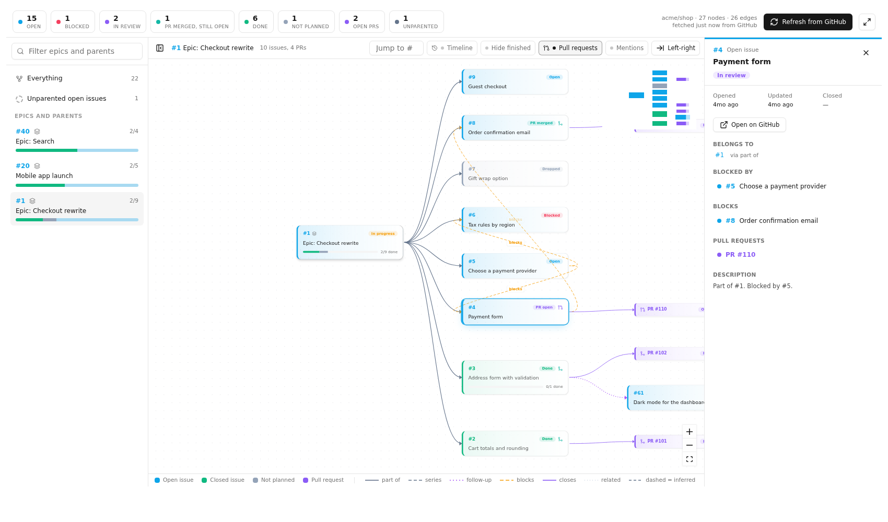

# Nurral-Issue-Mapper

Reads a GitHub repository's issues as a graph: which issue belongs to which epic,
what blocks what, which pull request is really finishing which issue, and what is
actually left. One program: a terminal report and an interactive page.



*An invented tracker (`--demo`), not a real project.*

## Try it first (no token, no repo)

```sh
docker run --rm -p 127.0.0.1:8080:8080 ghcr.io/simulationcoder/nurral-issue-mapper --demo serve --addr 0.0.0.0:8080
```

Open http://127.0.0.1:8080. It shows an invented tracker, so you can click around
before connecting anything. (With a downloaded binary: `issue-mapper --demo serve`.)

## Quick start for your own repo

**1. Create a token** that can read the repo's issues, at
https://github.com/settings/tokens:

- *Public repo:* any token works, even with no scopes.
- *Private repo:* a classic token with the `repo` scope, or a fine-grained token on
  that repo with read access to **Issues**, **Pull requests** and **Metadata**.

(With the downloaded binary you can skip this if you are logged in with the `gh` CLI: the program uses its login.)

**2. Run it.** With Docker, one command:

```sh
docker run --rm -p 127.0.0.1:8080:8080 \
  -e GITHUB_TOKEN=<your token> \
  -e ISSUE_MAPPER_REPO=your-org/your-repo \
  ghcr.io/simulationcoder/nurral-issue-mapper
```

Or with a downloaded binary (see Install below):

```sh
export GITHUB_TOKEN=<your token>
issue-mapper --repo your-org/your-repo serve
```

**3. Open http://127.0.0.1:8080.** Pick an epic on the left, click a card for its
details, press **Timeline** to replay how the tracker grew.

**4. Or stay in the terminal:**

```sh
issue-mapper --repo your-org/your-repo            # stats and the live epics
issue-mapper --repo your-org/your-repo merged-open
```

Inside a clone of your repo you can leave out `--repo`. With Docker, put the command
after the image name instead: `... ghcr.io/simulationcoder/nurral-issue-mapper merged-open`.

> The page has no login. Publish the port to `127.0.0.1` as above, not `0.0.0.0`,
> unless you put your own access control in front of it: it shows your private issues
> to anyone who can reach it. `serve` warns when it is bound beyond loopback.

## Why

A tracker with a few hundred issues records its structure in three different ways:
GitHub's native sub-issues, "Part of #12" in a body, and nothing at all on a series
titled "Checkout 3/8". Nobody holds that in their head. Issue Mapper reads all
three, builds one tree, and gives every issue one status:

| status | meaning |
|---|---|
| `done` / `dropped` | closed as completed / closed as not planned |
| `blocked` | depends on an issue that is still open |
| `in_review` | an open pull request is attached |
| `merged_open` | a merged pull request that **closes** it, but it is still open: probably needs closing |
| `in_progress`, `open` | everything else |

A pull request that only *mentions* an issue never marks it merged. Only a PR GitHub
links as closing it does.

## Install

**Download a binary** (Linux, macOS, Windows) from the
[Releases](https://github.com/simulationcoder/Nurral-Issue-Mapper/releases) page,
unpack it and put `issue-mapper` on your `PATH`. Check it with
`sha256sum -c checksums.txt`.

**Docker:** `docker pull ghcr.io/simulationcoder/nurral-issue-mapper`.

**From source** (Go 1.25+, and Node 20+ only to build the page):

```sh
git clone https://github.com/simulationcoder/nurral-issue-mapper
cd nurral-issue-mapper
make build            # writes bin/issue-mapper
```

## Use

Needs a GitHub token (`GITHUB_TOKEN`, `GH_TOKEN` or a logged-in `gh`). Run it inside a
clone, or pass `--repo owner/name` (or set `ISSUE_MAPPER_REPO`).

```sh
issue-mapper                    # stats and the live epics
issue-mapper epic 12            # one epic's children by status, blockers, open PRs
issue-mapper issue 34           # parent chain, children, PRs, dependencies
issue-mapper open --blocked     # blocked issues and what blocks them
issue-mapper merged-open        # finished work nobody closed
issue-mapper orphans            # open issues nothing claims
issue-mapper json               # the raw graph
issue-mapper serve              # the interactive page on http://127.0.0.1:8080
issue-mapper --demo             # any command on an invented tracker, no token needed
```

`--refresh` re-reads GitHub; otherwise a result is reused for five minutes.

The page has a tree view of every epic with status colours, filters (hide finished,
pull requests, mentions), a detail panel, and a **Timeline** that replays the tracker
day by day.

## Configure

Optional `.issue-mapper.yml` (see `.issue-mapper.yml.example`):

```yaml
repo: owner/name
epic_title: '(?i)^theme:'          # titles that mark an epic
series_title: '^(.*?)\s*\b(\d{1,2})\s*/\s*(\d{1,2})\b\s*[:\-–—]'
```

## How the hierarchy is read

Strongest first, one primary parent per issue: GitHub's native sub-issue parent; a
body reference (`Part of #N`, `Epic #N`, `follow-up to`, `found via`); a numbered
title series opened within half an hour of an epic (inferred); the first issue the
body mentions (inferred). Dependencies (`blocked by`, `depends on`), `supersedes`,
related mentions and pull request `closes`/`references` edges are returned alongside.

## Known limits

- A PR that finishes an issue but merged into a non-default branch, or that wrote
  "Part of #N", is not one GitHub links as closing, so the issue stays `open`.
- The timeline uses today's "closes" links for past days.
- Only the first 3,000 issues are read (30 pages of 100); the response says when it
  was cut short.

## Develop

```sh
go test ./...                         # graph rules, config, report
cd web && npm test                    # the browser timeline against the Go golden graph
cd web && npm run dev                 # page on :5173, proxying /api to `issue-mapper serve`
UPDATE_GOLDEN=1 go test ./internal/graph   # after changing the graph output
```

The browser's Timeline derives statuses a second time from each node's dates. The Go
tests write `internal/graph/testdata/parity.json`; `web/src/parity.test.ts` replays
it and must agree.

## Licence

Apache-2.0. See `LICENSE`.
